```{r, echo=FALSE}

knitr::opts_chunk$set(error = TRUE, warning = FALSE, message = FALSE)
knitr::opts_knit$set(root.dir = here::here())

```


# Introduction

This workshop will provide an introduction to the R programming language! 

Many psychology and neuroscience researchers use R to clean data, visualize data, and carry out statistical analyses.

By the end of this workshop series, we hope that you will feel comfortable enough to work independently in R.

This is the basic workflow that most R scripts work through, and it's the framework that we'll use today during the workshop. Hooray!


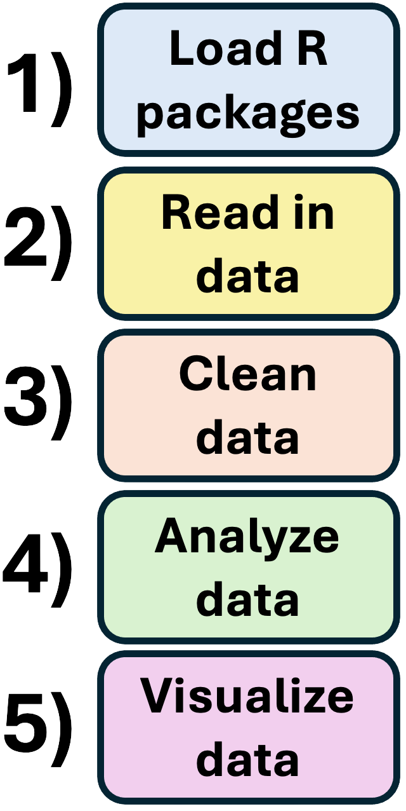{width=35% height=550px}


# Are you ready to start learning R?!

{width=70% height=400px}


# Intro to R Markdown

## Opening A New R Markdown File

First things first: if you haven't already done so, open R Studio. Next, you're going to want to open a new R Markdown document by clicking **File > New File > R Markdown...**  

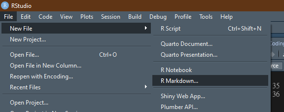
  
This should produce a dialogue box where you can enter the title of the script and your name before selecting **OK**.
  
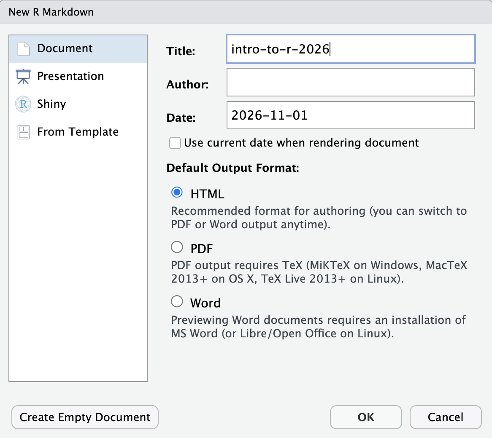{width=40%}

Next, let's clear out all of the default text that appears in a new R Markdown document, which I have highlighted below:

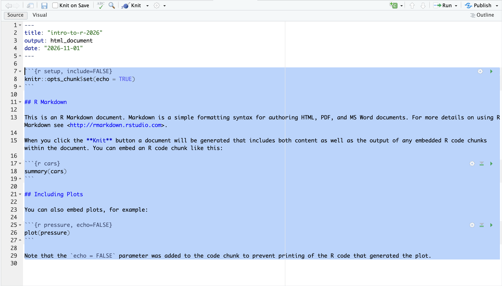 


## Using R Markdown

In a typical coding script, every line must contain code that the language could interpret. If you want to include notes, you have to include a hash mark (#) before any code in order for the program to “ignore this line”, which can get a bit annoying. An R Markdown script is much more user friendly.

With R Markdown, any code that you would like R to interpret belongs in the coding chunk as illustrated below.

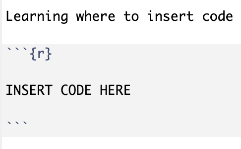{width=40%}

If we want to leave notes, we don’t have to “comment it out”. We can just write long-winded narration that can help others understand why we coded what we coded and what that code does. 

That’s because a typical script will interpret any text as a command, unless the text is otherwise marked by a hashtag (#). An R markdown script only interprets things as code when we tell it to, and we tell it what is code by creating a chunk. Chunks are marked by three backticks (```) followed by a {r} and, on another line, three more backticks.

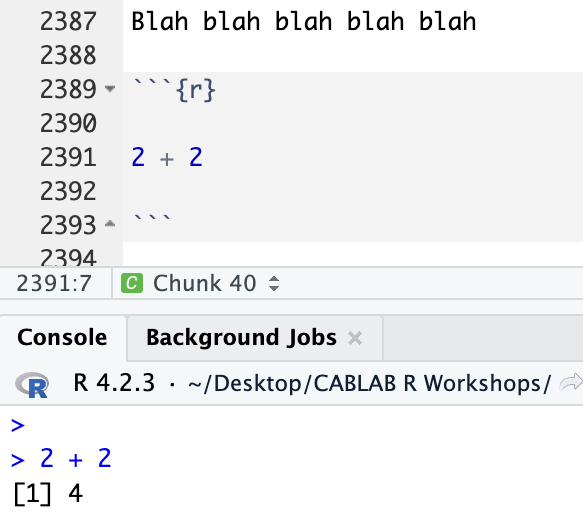{width=35%}

Here's a quick overview of the R Markdown chunk buttons you'll use most often (I took screenshots of the buttons in 'dark mode' please don't yell at me)

| Button | Name | Where to find it | What it does |
|:------:|:-----|:-----------------|:-------------|
| {height=22px} | **Run Current Chunk** | Top-right corner of the chunk | Runs all the code in this chunk |
| 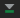{height=22px} | **Run All Chunks Above** | Top-right corner of the chunk | Runs every chunk *above* this one |
| 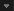{height=22px} | **Fold Code** | Left side, next to the line numbers | Collapses (hides) the chunk and its output to save space |
| 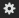{height=22px} | **Modify Chunk Options** | Top-right corner of the chunk | Opens settings for the given chunk |


  
# R Packages

## What's a "Package"?

Packages in R are synonymous with libraries in other languages. They are more or less convenient short-cuts or functions someone else already programmed to save us some work. Somebody else already figured out a very quick way to compute a function so now we don’t have to! We just use their tools to do it.


## Installing packages

Every new package is centralized in R’s repository, so even though thousands of people are working on these things independently, you don’t need to leave R to find them. Before they can be used, they must be installed, and you can do that in a pretty simple way:

Importantly, once you install a package, you don't need to install it again. R can remember which packages have been previously installed. This is true even if you are using the same package in different R Markdown scripts!

```{r install packages, eval = F}

install.packages("PACKAGENAME")

```


## Loading packages

Now that we have installed a package, that doesn’t mean we can use it yet. 

We need to tell R "We want access to the functions that this package has when running this R Markdown script" by calling it with the ```library()``` command.

```{r load package via library, eval = F}

library(PACKAGENAME)

```

Notice that we drop the quotation marks now. We just specify the (case-sensitive) package name and it lets R know we are planning on using that this session.

You might be wondering why we need to take this extra step. Sometimes different packages use the same commands, so having more than one of those active at the same time could confuse R (When this does happen, R will usually tell you). Sometimes packages take up a lot of disk space, so having ALL of your packages initialized at once might leave your computer running extremely slow. It’s the same for most languages.

Lastly, although you only need to install a package once, you have to load in any packages you want to use in a given R session. In other words, after installing a package, you can skip the ```install.packages()``` step, but you'll still need to run the ```library()``` step each time you want to use the package in an R script.

Let's practice installing and loading packages!


## Exercise: Installing and Loading Packages

We'll need these 4 packages for the rest of the workshop: **tidyverse**, **report**, **lme4**, and **ggplot2**.

**Step 1:** Use `install.packages()` to install all 4 packages. You only need to do this once per computer.

**Step 2:** Use `library()` to load all 4 packages. You'll need to do this every time you want to use these libraries in a given R script.

**Reminder**: `install.packages()` needs quotation marks around the package name, but `library()` doesn't!!!!

If a package loaded successfully, R won't print an error. Some packages (like tidyverse) print a list of messages when they load. That's annoying, but normal! You only need to worry if you see a message that starts with **`Error`**, or `there is no package called...`.

## Exercise: Installing and Loading Packages
```{r exercise: installing and loading packages, code="'\n\n\n\n'", results=F}


  
```


```{r exercise: installing and loading packages - hidden, eval=T, include=F}

library(tidyverse)
library(report)
library(lme4)
library(ggplot2)

```

[Click for solution](https://github.com/steventmartinez/intro-to-r-2026/blob/main/solutions/sol1.r)

  
# Palmerpenguins dataset 

For today's workshop, we'll be working with the palmerpenguins dataset. Please make sure you have the 2 CSV files (palmer-penguins_curated.csv and palmer-penguins_raw.csv) already downloaded!

The palmerpenguins data contains two datasets:

1) The **curated** dataset, which contains size measurements for 344 penguins from three penguin species observed on three islands in the Palmer Archipelago, Antarctica. 

2) The **raw** dataset, which contains additional information about the penguins.


{width=30%}
{width=50%}
<br>
Gorman KB, Williams TD, Fraser WR (2014). Ecological sexual dimorphism and environmental variability within a community of Antarctic penguins (genus Pygoscelis). PLoS ONE 9(3):e90081. https://doi.org/10.1371/journal.pone.0090081

# Working Directories


## File Paths

Before we start talking about "working directories", let's quickly unpack what a "file path" is on a computer.

"File paths" is just a fancy way to refer to the folders and subfolders that exist on someone's computer. Understanding how to navigate file paths is really important for being able to access specific files that you want to work with!

Here's an example of a file path: **"/Users/steven/Desktop/intro-to-r-2026-main"**

And here's a visualization of what that file path looks like on a computer:


Each part of the file path is a separate folder that we are traversing through.

File paths are especially important for setting your working directory and finding the data that you want to work with, just like we'll need to do for this workshop. 

## What is a working directory?

In order to start working with the palmerpenguins datasets, we need to revisit the concept of "file paths". We'll use our understanding of file paths to set our "working directory". At this point, some people may be wondering what a "working directory" is.

A working directory refers to the specific file path on your computer where R (or any programming language) will look for files by default. Like any other language or program, R needs to be told where the file that we’d like to work with is located on our computer. It doesn’t just know automatically where every file is on a person's computer. 

Below we'll use the ```getwd()``` command to find out where where your current working directory is.

```{r getwd(), eval=FALSE}

getwd() #get your current working directory

```

```{r getwd output, echo=FALSE}
"/Users/steven/Desktop/intro-to-r-2026-main"
```

As you can see, my working directory is currently set at: **"/Users/steven/Desktop/intro-to-r-2026-main"**

The output probably doesn't make much sense to anyone because this working directory file path is specific to my computer! Each of our working directory file paths will be specific to the computer we are using.


## Setting your Working Directory

In order to work with the palmerpenguins datasets, we need to tell R where the files are located. We can create a new object that stores a specific file path to make this process easier. File paths will differ based on whether you are using a Windows versus a Mac. 

If you're using a Windows computer, it's likely your file path will exist within your "C:/ Drive". 

If you're on a Mac, it's likely your file path will start with a forward slash "/".

```{r Setting Working Directory Example, eval=FALSE,include=TRUE, message=FALSE, warning=FALSE, error=FALSE}
# For Windows
Path <- "C:/"

# For Mac
Path <- "/"
``` 

On my computer, here's where the palmerpenguins data exists:

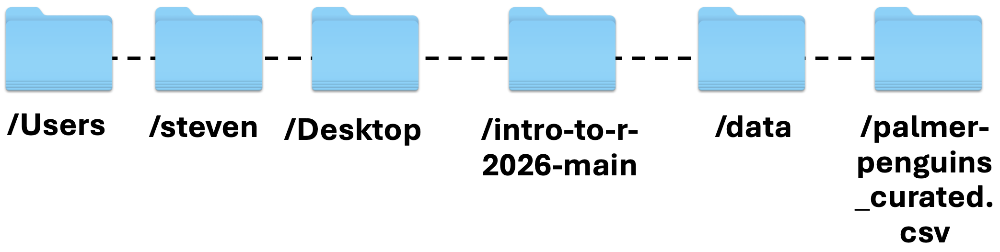

In order to work with the palmer-penguins_curated.csv file, I'll need to set my working directory to this file path!

Let's store this file path in an object called "Path".
```{r Setting Working Directory, eval=FALSE,include=TRUE, message=FALSE, warning=FALSE, error=FALSE}

# For Windows
Path <- "C:/Users/steven/Desktop/intro-to-r-2026-main/data/"

# For Mac
Path <- "/Users/steven/Desktop/intro-to-r-2026-main/data/"

```

```{r Actually Setting Working Directory, eval=TRUE,include=FALSE, message=FALSE, warning=FALSE, error=FALSE}
Path <- here::here("data/")
``` 

This format of assigning a value to an object, like we did with **Path** and **"/Users/steven/Desktop/intro-to-r-2026-main/data/"** is really important and we'll keep coming back to it throughout this tutorial. 

We'll next use this **Path** object to set our working directory using the ```setwd()``` command. The ```setwd()``` command tells R where to look for files on our computer.

```{r, set working directory, eval=FALSE}
setwd(Path) #use the setwd() function to assign the "Path" object that we created earlier as the working directory
```

```{r change root dir, echo=FALSE}
knitr::opts_knit$set(root.dir = here::here("data"))
```

Amazing! Now that our working directory is set to the correct file path, we can start load in the palmer-penguins data!

# Loading Data

## What is a "data frame"?
Before we load in the palmer-penguins data, I want to highlight a little terminology. The data that R works with is always contained within what we call a ‘dataframe’. A dataframe represents the same thing that a spreadsheet represents in Excel. It contains many cells that are situated into columns (which have names) and rows (which may or may not have names). 

## How do I load data into R?
There are many ways to load data into R and they all depend upon what format the data is in. R can handle data from .csv, .xlsx, .txt, .html, .json, SPSS, Stata, SAS, among others. R also has it’s own data format (.RDA, .Rdata). With the exception of .RDA, .csv is often the cleanest means of reading in data. We won’t cover the other formats, but they are fairly exhaustively covered *<hyperlink/in this tutorial/>*. https://www.datacamp.com/tutorial/r-data-import-tutorial

In the most basic sense, we can load our palmer-penguins_curated.csv data file using the read.csv() function like this:

The ```read.csv()``` command loads in the data. If done correctly, we should see our R **Environment** populate with a dataframe labeled **penguins**. 


```{r loading in data }
penguins <- read.csv(file = "palmer-penguins_curated.csv") #Load in the palmer-penguins_curated CSV file and store it in a data frame called "penguins"
```


IMPORTANT!!! This command ```read.csv(file = "palmer-penguins_curated.csv")``` is effectively the same as ```read.csv(file = "/Users/steven/Desktop/intro-to-r-2026-main/data/palmer-penguins_curated.csv")```


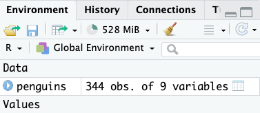  
<br>

Since we're all using the same dataset, the number of observations and variables should be the same as in the picture above. Here, you can think of observations as "rows" and variables as "columns". If you click on **penguins** in the Environment window, it will open in a new tab of your **Source Window** (The same window you are likely writing script in) where you can view it. 

We can also view the **penguins** data frame by using the ```View()``` command. This will lead to the same outcome as clicking on **penguins** in the Environment window. Do whatever you wanna do!!!

If we want to look at the first few rows of the penguins data frame, we can use the ```head()``` command.

```{r, head and View functions, eval=2}
View(penguins) #Will open up the full data frame
head(penguins) #Will show you the first six rows in the data frame
```


Another helpful command is ```colnames()```, which prints all the column names in a given data frame.

```{r colnames }

colnames(penguins) #print all the column names in a data frame

```

Amazing! Now let's get a better idea of what each column in the dataset actually represents:

| Column | Description |
|:-------|:------------|
| **sample_number** | Represents the continuous numbering sequence for each sample where data was collected |
| **species** | The three types of penguin species |
| **island** | The three types of island |
| **bill_length_mm** | A continuous number denoting bill length in millimeters |
| **bill_depth_mm** | An continuous number denoting bill depth in millimeters |
| **flipper_length_mm** | An integer number flipper length in millimeters |
| **body_mass_g** | An integer denoting body mass in grams |
| **sex** | Sex of the penguin |
| **year** | Year when the study took place |

## Data types in R

It's super important to recognize the different data types that exist in R. Some of the common data types include: character, factor, double/numeric, integer.

You may have noticed that for some variables, like **bill_length_mm**, the column description says "continuous number", whereas for other variables, like **flipper_length_mm**, the column variable says "integer". This is because R uses different data types, which we'll talk about more below.

Let's use the ```glimpse()``` command from the tidyverse library to print out the data type for each column in the penguins data frame.

```{r, use glimpse}
glimpse(penguins)
```

Here's a quick glossary for the common data types that appear in R:

| Data type | What it means |
|:----------|:--------------|
| **dbl** | Double/numeric: any continuous number, which can include decimals |
| **int** | Integer: whole numbers only, no decimals |
| **chr** | Character: string-based text |
| **fct** | Factor: text or numbers used to represent a category (think "Low", "Medium", "High" for text, or "1", "2", "3" for rankings) |

Now that we've got a better understanding of what data can look like in R, let's start working with the data.

# Subsetting data

## Accessing rows and columns in a dataset

By looking at the penguins data frame, we can see that we aren’t working with a perfectly clean dataset: some of the rows have missing data! And we may not need all of the columns in the dataframe.

So how do we work with specific rows? How do we work with specific columns? And how can we check what data is missing? Learning how to access specific elements of a data frame is an extremely important part of learning R.

dataframe$column will print out all the rows in that specific column. Let's print out all the rows in the **species** column.

```{r, index rows in column}

penguins$species #print all the rows in the 'species' column

```


Next, we will talk about indexing. Indexing refers to accessing specific rows or specific columns.

For instance, knowing that the 'species' column is the first column, I can use bracket notation. Bracket notation is super helpful once you understand its structure. It helps me to think of it as [rows, columns]. Any number that appears before the comma will access rows, and any number that appears after the comma will access columns.

By including the name of the data frame before the bracket notation, we can pull certain rows and columns from that data frame.

```{r, indexing elements}

penguins[1,] #print the first row across all columns

penguins[,2] #print all the rows in the second column

penguins[1,2] #print the first row in the second column

```

Now that we know how to access rows and columns, let's talk about subsetting! 

## Introduction to Subsetting

Subsetting is a technique for filtering rows or columns in a given data frame, usually to filter out any rows/columns you are not interested in using.

## Subsetting rows 

We can subset rows and columns, but let's start off with focusing on how we can subset specific rows.

We know that there are three penguin species in this dataset: Adelie, Gentoo, and Chinstrap.

Let's say we only wanted to focus on penguins from the Adelie species.

Thankfully, the filter() function from the **tidyverse** library makes subsetting a bit easier. Here, we will use the ```filter()``` function to subset the rows that represent penguins from the Adelie species and store these rows in a new data frame called "penguins_adelie".

Let's break down 2 operators here that are particularly important.

**%>%** refers to piping, which lets you pass the result of one function directly as the input to the next function. Here, all we are doing is feeding in the penguins data frame into the ```filter()``` function.

Notice the two equals signs (*==*) in this part of the code: ```filter(species == "Adelie")```

When two value operators (=, >, <, !) are placed next to each other in R, and many other languages, we aren’t assigning a value to an object; we are comparing the values between two different objects. In this instance, using two equals signs, if the two values are equal, it would produce a TRUE value; if not, then a FALSE. This variable which can only take the value of either TRUE or FALSE is called a boolean. When we tell R to compare the value on the right with this specific column, what it is mechanically doing is iterating through each row within this column, comparing the column value, and determining whether the condition is TRUE or FALSE.

```{r, subsetting rows}

penguins_adelie <- penguins %>%
  filter(species == "Adelie")

```

If you open up the penguins_adelie dataframe using ```View(penguins_adelie)``` or manually clicking on the new data object in the R Environment window, you should see that all the rows in the **species** column of this data frame reflect the **Adelie** species.
 
We can use this same strategy, piping (%>%) and value operators (==), to subset columns as well.


## Subsetting columns 

Let's say we were only interested in examining bill length, and not as interested in examining bill depth, flipper length, body mass, sex, and year.

We can use the ```select()``` function from the tidyverse library to keep certain columns (sample_number, species, island, and bill_length_mm), while also removing the columns we are not interested in (bill_depth_mm, flipper_length_mm, body_mass_g, sex, and year).

Here, we will use the ```select()``` function to assign the columns of interest (sample_number, species, island, bill_length_mm) into a new data frame called "penguins_bill_length".

```{r, subsetting columns}

penguins_bill_length <- penguins %>%
  select(sample_number, species, island, bill_length_mm)

```

If you open up the penguins_bill_length dataframe using ```View(penguins_bill_length)``` or by manually clicking on penguins_bill_length in the R Environment window, you should only see the columns that we wanted to keep (sample_number, species, island, bill_length_mm).


## Subsetting based on multiple conditions

What if, rather than subsetting based on one condition (i.e., subset all rows that represent penguins from the Adelie species), we wanted to subset based on multiple conditions? 

We can take advantage of the OR ( **|** ) operator using the ```filter()``` function.

Let's say we were only interested in examining Adelie or Gentoo penguins, but not Chinstrap penguins.

We can use the **OR** operator to tell R to subset all rows where species is equal to "Adelie" OR "Gentoo" and store it in a new data frame called "penguins_adelie_gentoo".

```{r, OR operator}

penguins_adelie_gentoo <- penguins %>%
  filter(species == "Adelie" | species == "Gentoo")

```

If you open up the **penguins_adelie_gentoo** data frame, you can see that all the rows in the 'species' column represent **Adelie** or **Gentoo** penguins, but not Chinstrap penguins

We can also take advantage of the AND ( **&** ) operator using the ```filter()``` function.

Let's say we were only interested in examining penguins from the Adelie species AND penguins that lived on Biscoe island.

We can use the **AND** operator to tell R to subset all rows in the species column that are equal to **Adelie** AND all rows in the island column that are equal to **Biscoe** and store these rows in a new data frame called "penguins_adelie_biscoe".

```{r, AND operator}

penguins_adelie_biscoe <- penguins %>%
  filter(species == "Adelie" & island == "Biscoe")

```

If you open up the **penguins_adelie_biscoe** data frame, you can see that all the rows in the 'species' column represent **Adelie** and all the rows in the 'island' column represent **Biscoe**. 

As you can see, leveraging the OR ( **|** ) and AND ( **&** ) operators in conjunction with the ```filter()``` function can be especially powerful.


## Exercise: Subsetting data

Let's try an exercise where we practice subsetting rows!

**Task:** Use `filter()` to keep only the penguins from the **Chinstrap** species in the `penguins` data frame, and save the result in a new data frame called **`penguin_chinstrap`**.

Feel free to copy and paste code from above, and tweak as needed!

When you are done, open `penguin_chinstrap` with `View(penguin_chinstrap)` or click it in the R Environment window. Every row in the `species` column should say "Chinstrap".

```{r subsetting exercise, code="'\n\n\n\n'", results=F}

  
```

```{r subsetting exercise - hidden, eval=F, include=F}
penguin_chinstrap <- penguins %>%
  filter(species == "Chinstrap")
```

[Click for solution](https://github.com/steventmartinez/intro-to-r-2026/blob/main/solutions/sol2.r)


## Missing data 

What if we wanted to see which rows had missing values (e.g., NA) or not? In other words, what if some penguins were missing information about their bill length? Let's go back to our original "penguins" data frame. 

Thankfully, R makes it relatively easy to identify and remove missing values (i.e., rows that have an 'NA') from a data frame.

We can use the drop_na() function from the tidyverse library to create a new data frame called "penguins_complete" that removes every row that contains an 'NA' in any column, which will ultimately leave us with a data frame with no missing values in any columns.

```{r, drop rows with missing values}

penguins_complete <- penguins %>% drop_na() #Remove every row that contains an 'NA' in any column

```


What if, instead of removing rows that have a missing value in **ANY** column, we wanted to remove any rows that have a missing value in **ONE** specific column? We can again use the drop_na() function and specify the specific column that we want to remove rows with missing values from.

Let's create a new data framed called **"penguins_bill_length_complete"** that only includes rows with no missing values in the **bill_length_mm** column.

```{r, drop missing values from specific column}

penguins_bill_length_complete <- penguins %>% drop_na(bill_length_mm)

```

As you can see, the **penguins_bill_length_complete** data frame only includes rows that do not have a missing value in the *bill_length_mm* column, but still have missing values in other columns (e.g., body_mass_g, sex)


What if, sometimes, the missing-ness of the data is represented not by NAs, but instead by blank values, by manually-entered text that says "NA", or by numeric values (999)?

The easiest way to resolve this is to convert these values to NAs, and then to use the ```drop_na()``` function like we did before.

```{r approach 1 missing values}

#Approach 1: Use base R to convert blank, missing, or numeric values to NAs so that we can use NA-based filtering functions, like drop_na()
penguins[penguins == ""] <- NA #Convert all blank values in the entire data frame to NAs
penguins[penguins == "NA"] <- NA #Convert all "NA" text values in the entire data frame to NAs
penguins[penguins == 999] <- NA #Convert all 999 numeric values in the entire data frame to NAs

#Now we can use the drop_na() function like we did before!
penguins_complete <- penguins %>% drop_na() #Remove every row that contains an 'NA' in any column


```


Now that we've clarified how to handle missing data, we are going to learn about how to use if-else statements.


# If-else statements in R

An if-else statement is a powerful control flow tool that allows a computer to make decisions and execute different code paths based on specific conditions.

It works kind of like a fork in the road: if a certain condition is true, the program follows one path of code; if the condition is false, it follows an alternative code path.

It can be helpful to think of it as a digital version of decision-making -— "If it's raining, I'll take an umbrella; else, I'll leave without one."

## General if-else structure
Here's an example of what a general if-else expression looks like in R. This is similar to the fork/umbrella analogies that we discussed earlier.

```{r, general if-else statements, eval = FALSE}

if (condition) { #if this condition is true
  expression #do this
} else { #if the condition is not true
  expression #do this instead
}

```

We can map this structure onto R's ```ifelse()``` function, which makes writing if-else statements a bit easier.

Let's use an if-else statement to create a new column that represents whether an island is in the "Eastern" or "Western" hemisphere of the world.

Let's say that the Biscoe island is in the Eastern hemisphere, and the Dream and Torgersen islands are in the Western hemisphere.

The structure for ifelse() statements is as follows: if the value in the **island** column has a cell that is equal to "Biscoe", R will insert a value of "Eastern" in the new **hemisphere** column for that corresponding cell, else, insert a value of "Western". 

We can use the ```mutate()``` function from the tidyverse to add the new "hemisphere" column to our penguins data frame.

```{r, ifelse() statement}

# Use mutate() with ifelse() to add a new column called "hemisphere" that reflects whether the island was located on the Eastern or Western hemisphere
penguins <- penguins %>%
  mutate(hemisphere = ifelse(penguins$island == "Biscoe", "Eastern", "Western"))

```

Here's what our code would look like within the general if-else expression that we showed above.

```{r, general if-else structure, eval = FALSE}

#General structure of if statement
if (penguins$island == "Biscoe") {
  penguins$hemisphere <- "Eastern"
} else {
  penguins$hemisphere <- "Western"
}

```


## For-loop with an if-else statement
We can also use a for-loop to accomplish the same outcome that we had when using the ```ifelse()``` function.

A for-loop is one of the main control-flow constructs of the R programming language. It is used to iterate over a collection of objects, such as a vector, a list, a matrix, or a dataframe, and apply the same set of operations on each item of a given data structure. 

For illustrative purposes, rather than overwriting the "hemisphere" column, let's make a new column called "hemisphere_duplicate"

```{r, for loop, eval = FALSE}

for (i in 1:length(penguins$island)) {               # 1) repeat once for every row in the 'island' column; i = 1, 2, 3, ...
  if (penguins$island[i] == "Biscoe") {              # 2) is the island in row i "Biscoe"?
      penguins$hemisphere_duplicate[i] <- "Eastern"  # 3) If yes -> write "Eastern" in row i
  } else {                                           # 4) If no...
      penguins$hemisphere_duplicate[i] <- "Western"  # 5) ...then write "Western" in row i
  }
}                                                    # 6) move to the next row and repeat


```


Let's break this for-loop down line by line.

1. **`for (i in 1:length(penguins$island)) {`**
   `i` is a temporary variable that keeps track of which row we're on. This part of the code `1:length(penguins$island)` creates the sequence 1, 2, 3... up until the last row. Each iteration of the loop moves `i` to the next row.

2. **`if (penguins$island[i] == "Biscoe") {`**
   Checks whether the island in row `i` is "Biscoe". On the first pass of the loop, R checks row 1; on the second pass, R checks row 2; and so on.

3. **`penguins$hemisphere_duplicate[i] <- "Eastern"`**
   If the island *is* "Biscoe", write "Eastern" into row `i` of the new `hemisphere_duplicate` column.

4. **`} else {`**
   If the island is *not* "Biscoe"...

5. **`penguins$hemisphere_duplicate[i] <- "Western"`**
   ...then put "Western" into row `i` of `hemisphere_duplicate`.

6. **`}`** (the final closing brace)
   Ends this pass of the loop. R adds 1 to `i` (which would move the loop onto the next row) and goes back to step 2, until every row has been checked.


# Merging data

Merging data frames allows us to combine different datasets based on common variables. In other words, merging data together allows us to combine information from multiple sources into a single, comprehensive dataset.

To illustrate why merging is especially powerful, let's start by reading in the **palmer-penguins_raw** CSV file, which contains additional information about the penguins.

```{r, read in penguins_raw CSV file}
penguins_raw <- read.csv(file = "palmer-penguins_raw.csv") #Load in the palmer-penguins_raw CSV file and store it in a data frame called "penguins_raw"
```

In the original penguins dataset that we've been working with, we can examine bill length (bill_length_mm) and flipper length (flipper_length_mm), but let's say we were really interested in examining culmen length (the ridge along the top part of a penguin's bill). Although the original penguins dataset does not have this information, the palmer-penguins raw dataset does!

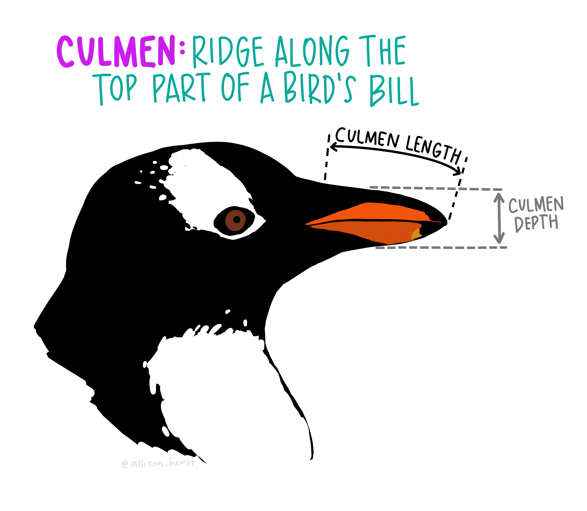{width=45%}

We can combine these two data frames into one data frame, so that we have all the information in one place.

Let's use the ```merge()``` function to merge the original penguins data frame and the penguins_raw data frame into a new data frame called "penguins_merged".

Here's the general structure of the `merge()` function:

- **`x` and `y`**: the two data frames you want to merge
- **`by`**: the column(s) that both data frames share, which R uses to **match up rows**. For two rows to be merge, they must have the *same values* in every `by` column.

Think of `by` as a matching function: R looks for the row in `penguins_raw` with the same sample number, species, island (and so on) as a row in `penguins`, and glues the two rows together side by side. Any columns that are *not* listed in `by` are simply carried along, so the merged data frame ends up with the columns from both.

```{r, merge data frames}

#Basic structure: new_df <- merge(x, y, by = c("col1", "col2", ...))
#penguins           = x: the first data frame
#penguins_raw       = y: the second data frame
#by =               = the columns both data frames share; rows are matched when ALL of these values are the same
penguins_merged <- merge(penguins, penguins_raw,
                         by = c("sample_number", "species", "island",
                                "flipper_length_mm", "body_mass_g", "sex"))

```

In our code, **x** and **y** represent the data frames we want to merge. All of the columns listed in the **by=c** expression represent the columns that are shared across both data frames (i.e., species, bill_length_mm, flipper_length_mm, body_mass_g, sex), so that R knows which columns we want to match across.

In this way, R will then be able to identify the columns that are NOT shared across the two data frames (i.e., bill_length_mm, bill_depth_mm, year, stage, clutch_competition, date_eg, culmen_length_mm, culmen_depth_mm, delta_15_n, delta_13_c, comments).

Now we have all the information we need in one place!


# Pivoting data from wide to long and long to wide

Next we will learn how to pivot data from wide to long, and long to wide. 

Before we get started with pivoting, let's subset a smaller data frame just to make it easier to work with.

Let's say we only wanted to focus on the length of different anatomical regions (i.e., bill, flipper, culmen). We can use the ```select()``` function to subset a data frame with the following columns: sample_number, species, island, bill_length_mm, flipper_length_mm, culmen_length_mm, and sex and store these columns in a new data frame called "penguins_length".

```{r, susbet data for long pivot}
penguins_length <- penguins_merged %>%
  select(sample_number, species, island, bill_length_mm, flipper_length_mm, culmen_length_mm, sex)
```

Perfect! Next let's break down what it means to pivot data.

## Pivot a data frame from wide to long
When data exists in a "wide" format, that means that each individual only has 1 row.

When data exists in a "long" format, that means that each individual has more than 1 row (i.e., repeated-measures). 

For the purposes of understanding how to pivot data frames, we will be using the **penguins_length** data frame that we just created. In order to do many statistical analyses, data usually needs to be in **long** format.

The ```pivot_longer()``` function can be used to pivot a data frame from wide format to long format.

```{r, pivot longer, echo=TRUE}

#Pivot from wide format to long format
penguins_long <- penguins_length %>%  #Start with the wide format data frame
  pivot_longer(
    cols = c("bill_length_mm", "flipper_length_mm", "culmen_length_mm"),  #The 3 columns that you will stack into one column
    names_to = "measure",     #A new column that holds the old column names (e.g., "bill_length_mm")
    values_to = "length"   #A new column that holds the VALUES/NUMBERS that were in those columns
  )
    
```

Here, we did a basic pivot longer to convert the data from wide to long, where the new column that we created ("measure") reflects the column names that we included in the **cols=c** argument of the pivot_longer function. The other new column that we created, "length", reflects the values from the columns that we included in the **cols=c** argument of the pivot_longer function.

This data frame is in **long** format because each penguin has 3 rows (1 for bill length, 1 for flipper length, and 1 for culmen length)

Pivoting data can be a bit tricky to understand at first, but hopefully this example helps!


## Pivot a data frame from long to wide

Data can also be converted from long to wide!

The ```pivot_wider()``` function can be used to pivot a data frame from long format to wide format.

Let's work on pivoting the long data frame that we created back to its original wide format!

```{r, pivot wider, echo=TRUE}

#Pivot from long format back to wide format
penguins_wide <- penguins_long %>%      #Start with the long format data frame
  pivot_wider(
    names_from = measure,     #Feed in the column whose entries become the new column names (e.g., "bill_length_mm")
    values_from = length   #Feed in the column whose VALUES/NUMBERS will fill in those new columns
  )

```

Here, we converted the data frame from long back to its original wide format! We know it's in wide format because each penguin now only has 1 row.

By including the "measure" column in the **names_from** argument, we are telling R that this is the column that will be used to generate new column names. By including the "length" column in the **values_from** column, we are telling R that this is the column whose values will be used to generate row values.


## Exercise: Pivoting data from wide to long

Let's try an exercise where we pivot data from wide to long!

**Step 1:** Use `select()` to keep only these 4 columns from the **`penguins_merged`** data frame, and save the result in a new data frame called **`penguin_pivot_exercise`**:

- `sample_number`
- `species`
- `bill_length_mm`
- `bill_depth_mm`

**Step 2:** Use `pivot_longer()` to pivot `penguin_pivot_exercise` from wide to long, and save the result in a new data frame called **`penguin_pivot_exercise_long`**:

- Stack the `bill_length_mm` and `bill_depth_mm` columns
- Name the column that holds the old column names as **`bill_measure`**
- Name the column that holds the values/numbers as **`length`**

**Step 3:** Check the new data frame! `penguin_pivot_exercise_long` should have 4 columns (`sample_number`, `species`, `bill_measure`, `length`) and **2 rows per penguin**, one for bill length and one for bill depth.

```{r Pivot Exercise, code="'\n\n\n\n'", results=F}


```


```{r Pivot Exercise - hidden, eval=F, include=F}
#1) Subset the following columns from the penguin_merged data frame and store them in a new data frame called "penguin_pivot_exercise": sample_number, species, bill_length_mm, bill_depth_mm
penguin_pivot_exercise <- penguins_merged %>%
  select(sample_number, species, bill_length_mm, bill_depth_mm)


#2) Pivot the data frame from wide to long
penguin_pivot_exercise_long <- penguin_pivot_exercise %>% pivot_longer(
                        cols=c("bill_length_mm", "bill_depth_mm"), #The names of the columns to pivot
                        names_to = "bill_measure", #The name for the new character column
                        values_to = "length") #The name for the new values column
```

[Click for solution](https://github.com/steventmartinez/intro-to-r-2026/blob/main/solutions/sol3.r)


# Statistical analyses: T-tests, ANOVAs, and Linear regresions

Next, we are going to start talking about different types of statistical analyses in R! 

We're going to focus on three common statistical analyses: t-tests, ANOVAs, and linear regressions.

We'll continue our focus on comparing the length of different anatomical parts (bill, flipper, and culmen) across penguin species in our statistical analyses below!

{width=70%}


## Prepping data before analyses

For our analyses, let's use the **penguins_length** data frame that we created earlier which includes the following columns:

- `sample_number`
- `species`
- `island`
- `bill_length_mm`
- `flipper_length_mm`
- `culmen_length_mm.`

To make things easier for our analyses, let's remove any rows with missing values in the data using the ```drop_na()``` function.

```{r, organize data for t-test}

penguins_length <- penguins_length %>% drop_na()

```

Now our data is ready to be analyzed!

## T-tests

A t-test can be used when both the predictor variable consists of two categorical options and the outcome or dependent variable is numeric in value. A t-test tells you how significant the differences between these categories or groups are. In other words, it lets you know if the differences between the means of two groups could have observed by chance. We could imagine a situation where an evil teacher told half of the class before a test the right chapter to study from and told the other half of the class the wrong chapter to study from. The two categories or groups might be Right Chapter and Wrong Chapter and the outcome variable would be Test Score. Using a T-Test, we could determine whether studying from the right chapter produces higher test scores. 

Below, we propose a research question and t-test analysis.

**QUESTION**: Do Adelie and Gentoo penguins differ in flipper length?

**HYPOTHESIS**: On average, Adelie and Gentoo penguins differ in flipper length.

**RELEVANT VARIABLES**: Dependent variable: flipper_length_mm (numeric), Independent variable: species (Factor)

**ANALYSIS**: Unpaired Two-Samples T-Test

Now let's do the t-test!

We'll need to use conditional statements again to specify our variables. What we are comparing here are the mean values of flipper length for Adelie and Gentoo penguins. As such, we are going to specify we want flipper length when species == "Adelie" and when species == "Gentoo. We next have an argument which asks us whether this analysis is within-subjects or between-subjects. This question is between-subjects (independent samples), since each penguin is either from the Adelie species or the Gentoo species, so we'll mark that as FALSE. Lastly, R is asking us to define our alternative hypothesis, which is a little beyond the scope of this review, so you will have to take my word that “two.sided” is the right call. 


```{r, t-test}

model1 <- t.test(
  x = penguins_length$flipper_length_mm[penguins_length$species == "Adelie"],  #Group 1: flipper lengths of Adelie penguins
  y = penguins_length$flipper_length_mm[penguins_length$species == "Gentoo"],  #Group 2: flipper lengths of Gentoo penguins
  paired = FALSE,               #FALSE = different penguins in each group (independent samples so unpaired t-test!!!)
  alternative = "two.sided"     #Test for a difference in either direction (Adelie > Gentoo or Adelie < Gentoo)
)

#Print the model results
model1

```


We can observe the results of our t-test by printing the **model1** data object that we created. However, some hero created the ```report``` package which makes interpreting results a little easier!

Let's use the ```report()``` function from the report library to help with our interpretation of the t-test results.

```{r, report t-test, warning=FALSE}

report(model1)

```


So it looks like our hypothesis panned out! We see statistically significant differences, judging by the model output (t(251.35) = -33.51, p-value < .001). Since penguins from the Adelie species were our reference group, the negative value of the T-statistic indicates that the first group (Adelie) has a lower mean than the second group (Gentoo). In other words, on average, penguins from the Gentoo species have a longer flipper length than penguins from the Adelie species.

Next we'll talk about running an ANOVA test!


## ANOVAs

An ANOVA, or Analysis of Variance, can be used when both the predictor variable or variables consist of two or more **categorical** options and the outcome or dependent variable is **numeric** in value. Much like a t-test, an ANOVA tells you how significant the differences between these categories or groups are. The advantage over T-tests is that we can compare multiple groups or categories in one analysis. We could revisit our last horrible example and imagine that the evil teacher tells one group right chapter to study from, one group the wrong chapter to study from, and one group to not study at all. An ANOVA test will tell us whether any of these three groups are different from one another (but not necessarily which specific groups are different from one another). 

Using the penguins_merged dataframe, we'll run a similar analysis that we did for the t-test, but this time, rather than only using two penguin species (Adelie and Gentoo), we'll include all three penguin species (Adelie, Gentoo, and Chinstrap).

**QUESTION**: Does bill length differ across penguin species (i.e., Adelie, Gentoo, Chinstrap)?

**HYPOTHESIS**: There are differences in bill length across penguin species.

**RELEVANT VARIABLES**: Dependent variable: bill_length_mm (numeric) Independent variable: species (factor with 3 levels)

**ANALYSIS**: ANOVA

Pay close attention to the formatting of the syntax here. It is the standard way in which we specify most statistical models in R, whether for regression, ANOVA, hierarchical modeling etc.

```{r, ANOVA}

#Run a one-way ANOVA and save the results in an object called model2
# bill_length_mm  = outcome (dependent variable), on the left side of the ~
# ~               = "is predicted by"
# species         = predictor (independent variable), on the right side of the ~
# data =          = the data frame that has both columns
model2 <- aov(bill_length_mm ~ species, data = penguins_length)

#Print summary of model results
summary(model2)

```

The ```report()``` function works equally well on ANOVA models, too.
```{r, report ANOVA}

report(model2)

```

It seems that the main effect of species has a significant effect on the length of bills, judging by the model output (F(2, 330) = 397.30, p-value < .001)

Next, we'll switch to linear regressions!


## Linear regressions (Bivariate and Multivariate)

A bivariate linear regression can be used when both the predictor variable (X) and outcome variable (Y) consist of continuous numeric values. A linear regression tells us how predictive of Y that X is. In other words, if we measured temperature and ice cream sales, we might find, using linear regression that as temperature increases, we could predict with decent accuracy that ice cream sales would increase as well, and we could predict how many ice cream sales we expect to see for any one value of temperature. 

Within the context of the penguins dataset, we could ask a question like whether the length of penguins' bills predicts the length of their flippers.

**QUESTION**: Does bill length predict flipper length?

**HYPOTHESIS**: As bill length increases, flipper length also increases.

**RELEVANT VARIABLES**: Dependent variable: Flipper length (numeric) Independent variable: Bill length (numeric)

**ANALYSIS**: Bivariate Linear Regression

Okay now it's time to run our regression!

You’re going to notice right off the bat that the structure of the syntax here looks super similar to what we just did for the ANOVA. We start by noting our method with the lm() function (Linear Modeling). We then note our outcome variable, add a tilde (~), note our predictor(s), and finally note our datasource.


```{r, bivariate linear regression}

#Run a bivariate linear regression and save the results in an object called m1
m1 <- lm(flipper_length_mm ~ bill_length_mm, data = penguins_length) 

```

Just like for the ANOVA, we need to use the summary() function to read the data.

```{r, summary of bivariate linear regression}

#Use summary() function to print summary for m1 bivariate linear model
summary(m1) 

```

Lastly, we can run the report() function for linear regression models too!

```{r, report bivariate linear regression}

#Use report() function to print report for m1 bivariate linear model
report(m1) 

```

Linear regression results show that bill length statistically predicts flipper length, as observed by model output stats: (beta = 1.67, 95% CI [0.57, 0.73], t(331) = 15.69, p < .001).


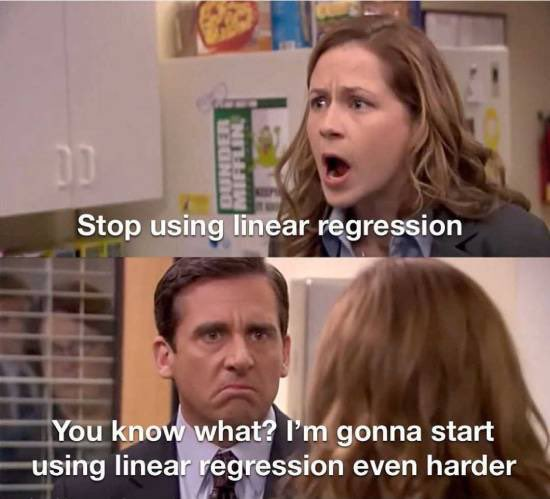

## Multivariate Linear Regression
Whereas bivariate linear regression uses 1 independent predictor and 1 dependent variable (hence, "bi"), a multivariate linear regression builds upon bivariate regression by allowing for more than 1 predictors (hence "multi"). If we measured temperature, ice cream sales, and the time since someone last ate, we might find that our previously specified model is now even more accurate because of the addition of the “time since last ate” variable. 

Using the penguins data, let’s examine if bill length still predicts flipper length when controlling for differences in sex.

**QUESTION**: Does bill length predict flipper length when accounting for the effect of sex?

**HYPOTHESIS**: Bill length still predicts flipper length when controlling for sex.

**RELEVANT VARIABLES**: Dependent variable: flipper length (numeric) Independent variables: Bill length (numeric) and sex (factor)

**ANALYSIS**: Multivariate Linear Regression


```{r, multivariate linear regression}

#Run a multivariate linear regression and save the results in an object called m2
m2 <- lm(flipper_length_mm ~ bill_length_mm + sex, data = penguins_length)

```

Just like we did for the bivariate linear regression, we need to use the summary() function to read the data.

```{r, summary of multivariate linear regression}

#Use summary() function to print summary for m2 multivariate linear regression model
summary(m2) 

```


Lastly, we can run the ```report()``` function for linear models as well!

```{r, report multivariate linear regression}

#Use report() function to print report for m2 multivariate linear regression model
report(m2)

```

Multivariate linear regression results indicate that bill length still statistically predicts flipper length when accounting for differences in sex, as observed by model output stats for the effect of bill length: (beta = 1.64, 95% CI [1.42, 1.87], t(330) = 14.46, p < .001).

Hopefully these analyses have made sense! Our hope is that you can use this analysis code to conduct your own analyses in your own research!


# Visualizing data

Next we'll start talking about how to make graphs in R!

ggplot2 is an extremely popular plotting package in R that makes it fairly easy to create complex plots from data in a data frame.

ggplot2 refers to the name of the package itself, whereas we use the ```ggplot()``` function to generate the plots. We're going to start off with building a very simple plot, and then we will add in some more lines to organize a plot like you would for a manuscript/publication!

## Histograms

We can start off by generating a histogram to visualize our dataset and see the distribution of flipper length and color code it by penguin species. The ```geom_histogram()``` argument is what allows us to make the histogram!

```{r, histogram}


# Make a histogram of flipper length, with bars colored by species
# penguins_length    = the data frame to plot
# aes()              = "aesthetics": maps columns to parts of the plot
# x =                = the column to show on the x-axis (flipper length)
# fill =             = the column that sets the bar colors (species)
# +                  = adds the next layer to the plot
# geom_histogram()   = draws the data as histogram bars
ggplot(penguins_length,            
       aes(x = flipper_length_mm,  
           fill = species)) +      
  geom_histogram()                 

```

Histograms are a very helpful way to visualize data and better understand the distribution of specific variables of interest, and can also be helpful for visually identifying outliers.

Next, we'll move onto creating bar plots and adding standard error bars to graphs! 

## Bar plots with standard error bars

Let's plot the ANOVA we ran earlier, where we examined whether bill length differed across the three penguin species.

In order to add standard error bars to a plot, we first need to run the ```summarySE()``` function that will calculate the standard error for our dependent variable (bill length).

As a quick reminder, standard error bars reflect the uncertainty or variability in the mean value that's being displayed. In other words, they indicate how precisely we know the true population mean - a smaller standard error suggests we can be more confident in our estimate, while larger error bars indicate more uncertainty. The standard error is calculated by dividing the standard deviation by the square root of the sample size.

The ```summarySE()``` function is appropriate when working with between-subjects variables. If you have within-subjects variables and want to adjust the error bars so that inter-subject variability is removed as suggested in Loftus and Masson (1994), then the other two functions, normDataWithin() and summarySEwithin() must also be added to your code; summarySEwithin would then be the function that you call.

You don't have to change anything in this code -- just run it as it is! All this code is doing is authorizing the use of the ```summarySE()``` function.

```{r, standard error function}

## Gives count, mean, standard deviation, standard error of the mean, and confidence interval (default 95%).
##   data: a data frame.
##   measurevar: the name of a column that contains the variable to be summariezed
##   groupvars: a vector containing names of columns that contain grouping variables
##   na.rm: a boolean that indicates whether to ignore NA's
##   conf.interval: the percent range of the confidence interval (default is 95%)
summarySE <- function(data = NULL, measurevar, groupvars = NULL,
                      na.rm = FALSE, conf.interval = .95) {
  data %>%
    group_by(across(all_of(groupvars))) %>%             # group by your grouping variable(s)
    summarise(
      N    = if (na.rm) sum(!is.na(.data[[measurevar]])) else n(),  # sample size
      mean = mean(.data[[measurevar]], na.rm = na.rm),              # mean
      sd   = sd(.data[[measurevar]], na.rm = na.rm),                # standard deviation
      .groups = "drop"
    ) %>%
    rename(!!measurevar := mean) %>%                    # rename "mean" to your variable's name
    mutate(
      se = sd / sqrt(N),                                # standard error of the mean
      ci = se * qt(conf.interval / 2 + .5, N - 1)       # confidence interval
    ) %>%
    as.data.frame()
}


```


## Calculating the standard error

Now that we have the ```summarySE()``` function loaded in, we can calculate the standard error of bill length for each penguin species.

Below, we will use the ```summarySE()``` function where the **measurevar** argument reflects our dependent variable (bill_length_mm) and the **groupvars** argument reflects our independent variable (species).

```{r, summarySE() on data}
# summarySE provides the standard deviation, standard error of the mean, and a (default 95%) confidence interval
penguins_length.se <- summarySE(penguins_length, measurevar="bill_length_mm", groupvars=c("species"))

#We can print this new data frame to see what information is stored there
print(penguins_length.se)
```

Great! We can see that the **penguins_length.se** data frame includes the mean, standard deviation, standard error, and confidence intervals for our dependent variable of interest (bill length) across the three penguin species.

Now that we have the standard errors calculated, we can use this data frame, rather than the raw data frame, to plot mean values with standard errors bars that represent bill length across the three penguin species.

```{r, barplot}

#Make a bar plot with mean values and standard error bars
ggplot(penguins_length.se, aes(x = species, y = bill_length_mm, fill = species)) + #Plot the variables using the penguins_length.se data frame
      geom_bar(stat="identity") + #Use the geom_bar() function to generate a bar plot
      geom_errorbar(aes(ymin=bill_length_mm-se, ymax=bill_length_mm+se), #Use the geom_errorbar() function to plot the standard error bars
                  width=.2, # Define the width of the error bars
                  position=position_dodge(.9)) 
```

As a visual confirmation of our ANOVA results, we can see that there are indeed differences in bill length across the penguin species -- most notably with the bill length of the Gentoo and Chinstrap penguins differing from the bill length of Adelie penguins.


## Scatterplot with linear regression line

Next, we'll visualize the bivariate linear regression that we ran above, where we examined whether bill length predicted flipper length in penguins.

We can use a scatterplot to visualize this relationship and add a linear regression line to the plot.

```{r}
ggplot(penguins_length, aes(x=bill_length_mm, y=flipper_length_mm)) + #Plot the variables we are interested in
   geom_point() + #geom_point() is the function used to create scatter plots
   geom_smooth(method=lm, color="black")  #Adds a linear regression line to your plot
```

Amazing! Now we have a visual representation of what our bivariate linear regression results look like. It's clear that as bill length increases, so does flipper length.

Hopefully this part has been helpful for learning how to visualize data!

# Tidy pipeline

So far, we've covered quite a lot in separate sections! To end the R workshop, we wanted to put together a complete pipeline that you can use to analyze your own data in the future, starting with loading R packages, reading data into R, cleaning the data up, running a t-test, and then visualizing the results.

Let's say our goal was to examine whether bill length significantly differs from flipper length in penguins.

Here's what a complete pipeline could look like to address this question using the **tidyverse** library in R!

```{r, tidy pipeline, eval=FALSE}

#Step 1: Load the R packages you will be working with (this assumes that you've previously installed the R packages).
library(tidyverse)
library(report)
library(lme4)
library(ggplot2)

#Step 2: Read the data into R
penguins <- read.csv(file = "palmer-penguins_curated.csv") #Load in the penguins CSV file and store it in a data frame called "penguins"

#Step 3: Subset the columns you are interested in using the select() function
penguins_length_pipeline <- penguins %>%
  select(sample_number, species, island, bill_length_mm, flipper_length_mm)

#Step 4: Pivot data frame from wide to long
penguins_pipeline_long <- penguins_length_pipeline %>% pivot_longer(
                        cols=c("bill_length_mm", "flipper_length_mm"), #The names of the columns to pivot
                        names_to = "anatomical_region", #The name for the new character column
                        values_to = "length") #The name for the new values column

#Step 5: Clean your data and remove any rows with missing values
penguins_pipeline_long <- penguins_pipeline_long %>% drop_na()


#Step 6: Run a t-test to determine whether bill length significantly differs from flipper length
model2 <- t.test(x = penguins_pipeline_long$length[penguins_pipeline_long$anatomical_region == "bill_length_mm"],
                y = penguins_pipeline_long$length[penguins_pipeline_long$anatomical_region == "flipper_length_mm"],
                paired = FALSE,
                alternative = "two.sided")

#Step 7: Interpret results of t-test output
report(model2)

#Step 8: Calculate the standard errors before plotting
#summarySE provides the standard deviation, standard error of the mean, and a (default 95%) confidence interval
penguins_pipeline_long.se <- summarySE(penguins_pipeline_long, measurevar="length", groupvars=c("anatomical_region"))

#Step 9: Create bar plot with standard error bars to visualize t-test
ggplot(penguins_pipeline_long.se, aes(x = anatomical_region, y = length, fill = anatomical_region)) + 
      geom_bar(stat="identity") +
      geom_errorbar(aes(ymin=length-se, ymax=length+se), 
                  width=.2, 
                  position=position_dodge(.9)) 

#Step 10: All done!!!

```


# Conclusion

Congrats!!! You made it through an R workshop!! Hopefully you feel like you’re starting to pick up on some things! It’s also totally okay if things aren’t clicking just yet, but regardless of how you may be feeling, I will always be happy to work with you if you have any specific questions as you move forward on your coding journey! Hooray!!!


