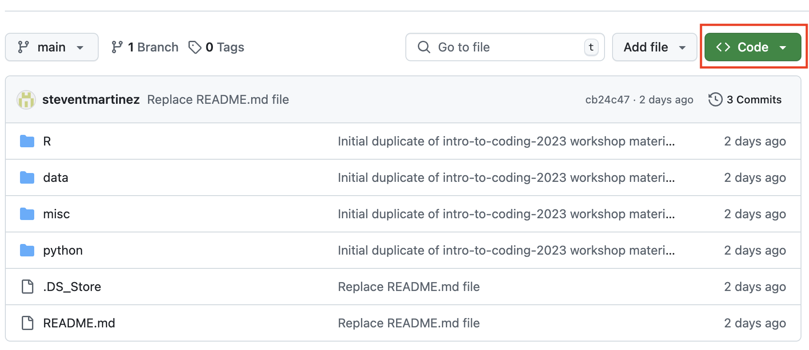

# Intro to R (Winston Center edition)
11/12/2026  

## Description
This workshop will provide an introduction to the R programming language! 

Many psychology researchers use R for cleaning data, visualizing data, and carrying out statistical analyses.

By the end of this workshop series, our hope is that you will feel comfortable enough to work independently in R!

## To-do before the tutorial
1. **Download R**  
         Windows: https://cran.r-project.org/bin/windows/base/  
         Mac: https://cran.r-project.org/bin/macosx/         
         
2. **Download RStudio** (which allows us to work with R, but is a different program from R)  
         Windows or Mac: https://docs.posit.co/ide/user/download.html

3. **Download the workshop materials on this page!**  
         Press the green **Code** button and download the ZIP folder. This is the folder containing all the files we will be working with for this workshop.

## Tutorial objectives:
- Become familiar with RStudio and Rmarkdown (and more generally notebook style coding)
- Understand how to set a working directory and navigate file paths
- Learn how to load and clean data
- Conduct statistical analyses
- Learn how to visualize data

## Workshop Materials
- [Notebook Viewer](https://steventmartinez.github.io/intro-to-coding-2026/index.html)